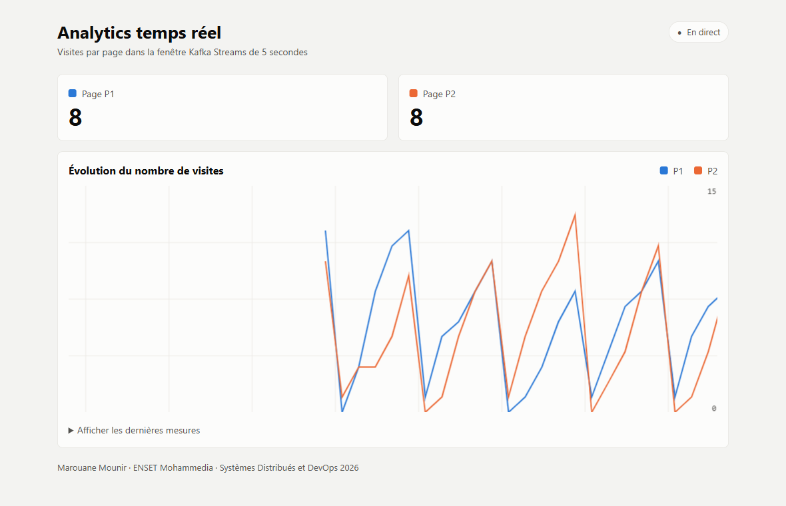
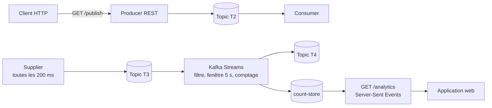

# Activité Pratique N°3 : Event Driven Architecture

**Module :** Systèmes Distribués et DevOps 2026
**Réalisé par :** Marouane Mounir
**Encadré par :** Pr. Mohamed Youssfi
**Établissement :** ENSET Mohammedia

## Objectif

Mettre en œuvre une architecture pilotée par les événements avec Apache Kafka, Spring Cloud Stream et Kafka Streams, depuis l'installation du broker jusqu'à l'affichage d'analyses en temps réel dans une application web.



## Travail réalisé

- [x] [Partie 1 : Kafka en local avec ZooKeeper](docs/01-kafka-local.md)
- [x] [Partie 2 : Kafka avec Docker Compose](docs/02-kafka-docker.md)
- [x] [Partie 3 : Spring Cloud Stream et Kafka Streams](docs/03-spring-cloud-stream.md)
  - [x] Service Producer via un REST Controller
  - [x] Service Consumer
  - [x] Service Supplier
  - [x] Service de Data Analytics avec Kafka Streams
  - [x] Application web affichant les résultats en temps réel

## Architecture



## Concepts clés

| Concept | Description |
|---|---|
| Communication asynchrone | Le producteur publie un événement sans attendre le consommateur, qui le traite à son rythme |
| Topic | Flux d'événements découpé en partitions et conservé sur disque |
| Consumer group | Les instances d'un même groupe se partagent les messages, alors que des groupes différents reçoivent chacun tous les messages |
| Modèle pull | Le consumer décide quand lire et quelle quantité de messages récupérer |
| ZooKeeper | Coordonne le cluster : état des brokers et élection des leaders |
| Stream processing | Traitement continu des événements, par opposition au traitement différé en batch |
| Spring Cloud Stream | Abstraction fonctionnelle (`Supplier`, `Consumer`, `Function`) indépendante du broker |

## Technologies

| Technologie | Version |
|---|---|
| Java | 21 |
| Spring Boot | 3.5.16 |
| Spring Cloud | 2025.0.3 |
| Apache Kafka (installation locale) | 3.9.2 |
| Confluent Platform (Docker) | 7.6.1 |
| Smoothie Charts | 1.34.0 |

## Structure du projet

```text
.
├── docker-compose.yml
├── docs/
└── kafka-spring-cloud-stream/
    ├── pom.xml
    └── src/
        ├── main/java/ma/enset/kafkaspringcloudstream/
        │   ├── controllers/PageEventController.java
        │   ├── events/PageEvent.java
        │   └── handlers/PageEventHandler.java
        ├── main/resources/
        │   ├── application.properties
        │   └── static/index.html
        └── test/java/ma/enset/kafkaspringcloudstream/handlers/PageEventStreamTest.java
```

## Lancer le projet

Prérequis : Java 21 et Docker Desktop.

Démarrer Kafka depuis la racine du dépôt :

```powershell
docker compose up -d --wait
```

Démarrer l'application :

```powershell
cd kafka-spring-cloud-stream
```

```powershell
.\mvnw.cmd spring-boot:run
```

Ouvrir le tableau de bord sur <http://localhost:8080/index.html>. Les courbes apparaissent une fois Kafka Streams démarré, soit environ 20 secondes.

Publier un événement :

```powershell
curl.exe "http://localhost:8080/publish?name=P1&topic=T2"
```

Arrêter Kafka :

```powershell
docker compose down
```

## Endpoints

| Méthode | URL | Description |
|---|---|---|
| `GET` | `/publish?name=P1&topic=T2` | Publie un `PageEvent` dans le topic indiqué |
| `GET` | `/analytics` | Diffuse les compteurs en Server-Sent Events |
| `GET` | `/index.html` | Affiche le tableau de bord |

## Conclusion

Cette activité a permis de construire une chaîne événementielle complète : production, consommation, traitement en temps réel par fenêtres et visualisation. Kafka découple les services, conserve les événements et permet de les traiter en continu, tandis que Spring Cloud Stream garde le code métier indépendant du broker.
