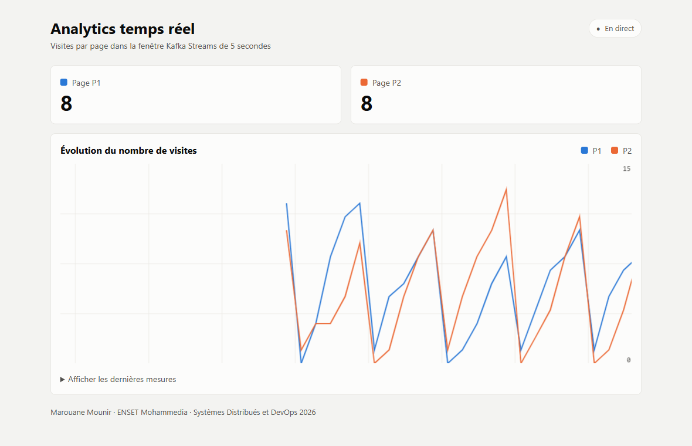

# Partie 3 : Spring Cloud Stream et Kafka Streams

## Services réalisés

| Service | Implémentation | Entrée | Sortie |
|---|---|---|---|
| Producer REST | `PageEventController.publish` avec `StreamBridge` | `GET /publish` | Topic choisi, `T2` par défaut |
| Consumer | Bean `Consumer<PageEvent>` | `T2` | Logs de l'application |
| Supplier | Bean `Supplier<PageEvent>` | Poller de 200 ms | `T3` |
| Data Analytics | Bean `Function<KStream, KStream>` | `T3` | `T4` et `count-store` |
| Diffusion temps réel | `PageEventController.analytics` | `count-store` | Server-Sent Events |
| Application web | `static/index.html` avec Smoothie | `GET /analytics` | Tableau de bord |

## Traitement Kafka Streams

1. `filter` conserve les visites de plus de 100 ms.
2. `map` utilise le nom de la page comme clé.
3. `groupByKey` regroupe les événements par page.
4. `windowedBy` crée des fenêtres fixes de 5 secondes.
5. `count` matérialise les compteurs dans le state store `count-store`.
6. `toStream` et `map` publient les résultats dans `T4`.

Le compteur repart de zéro à chaque nouvelle fenêtre, ce qui donne aux courbes leur forme en dents de scie.

## Choix d'implémentation

- L'itérateur du state store est fermé avec un `try-with-resources` pour éviter une fuite de ressources RocksDB.
- `/analytics` renvoie un objet vide tant que Kafka Streams démarre, ce qui garde la connexion ouverte.
- `spring.mvc.async.request-timeout=-1` empêche la coupure du flux SSE après 30 secondes.
- `onBackpressureDrop` ignore un tick si le navigateur ne suit pas le rythme.

## Tests réalisés

### Producer REST

```powershell
curl.exe "http://localhost:8080/publish?name=P1&topic=T2"
```

```json
{"name":"P1","user":"U2","date":"2026-11-22T23:37:56.312+00:00","duration":6670}
```

### Consumer sur T2

```text
Événement reçu : PageEvent[name=P1, user=U2, date=Mon Nov 23 00:37:56 WEST 2026, duration=6670]
```

### Supplier sur T3

```powershell
docker exec -it bdcc-kafka-broker kafka-console-consumer --bootstrap-server localhost:9092 --topic T3
```

```json
{"name":"P1","user":"U2","date":"2026-11-22T23:37:40.513+00:00","duration":4602}
{"name":"P2","user":"U1","date":"2026-11-22T23:37:40.846+00:00","duration":3038}
```

### Résultats Kafka Streams sur T4

```powershell
docker exec -it bdcc-kafka-broker kafka-console-consumer --bootstrap-server localhost:9092 --topic T4 --property print.key=true --key-deserializer org.apache.kafka.common.serialization.StringDeserializer --value-deserializer org.apache.kafka.common.serialization.LongDeserializer
```

```text
P2    15
P1    10
P1    1
P2    2
```

### Flux Server-Sent Events

```powershell
curl.exe -N http://localhost:8080/analytics
```

```text
data:{"P1":6,"P2":8}
data:{"P1":10,"P2":9}
data:{}
data:{"P1":2,"P2":2}
```

Un objet vide indique qu'aucune visite n'a encore été comptée dans la nouvelle fenêtre.

### Tests unitaires

`PageEventStreamTest` vérifie la topologie avec `TopologyTestDriver`, sans broker : filtrage, comptage par page et changement de fenêtre.

```powershell
.\mvnw.cmd test
```

```text
Tests run: 3, Failures: 0, Errors: 0, Skipped: 0
```

## Application web


